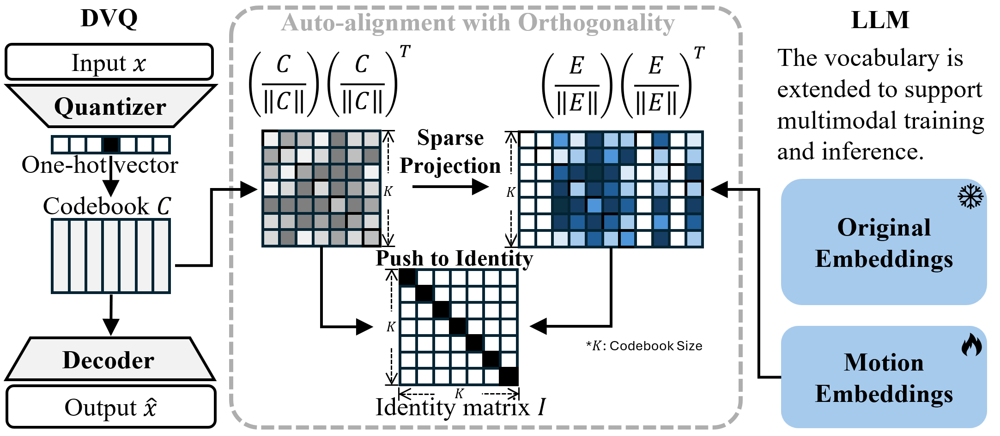

<div align="center">

# GeoMotionGPT

### Geometry-Aligned Motion Understanding with Large Language Models

[](https://aclanthology.org/2026.emnlp-main.179/)
[](LICENSE)
[](https://huggingface.co/zy22b/GeoMotionGPT)
[](https://www.python.org/downloads/)
[](https://pytorch.org/)



</div>

---

## 📋 Table of Contents

- [Overview](#-overview)
- [News](#-news)
- [Setup](#️-setup)
- [Quick Start](#-quick-start)
- [Training](#-training)
- [Citation](#️-citation)
- [Acknowledgements](#-acknowledgements)

---

## 🔍 Overview

**GeoMotionGPT** is a novel framework for motion-to-text generation that bridges the gap between human motion understanding and natural language generation. Our key contributions include:

- 🎯 **Geometry-Aligned Tokenization**: A decoder-only vector quantizer (DVQ) that preserves geometric structure of motion data
- 🔗 **Orthogonal Motion Embeddings**: Regularization technique ensuring motion tokens are well-separated in embedding space  
- 🧠 **GPT-2 Fine-tuning**: Efficient adaptation of pretrained language models for motion captioning

---

## 📰 News

| Date | Update |
|------|--------|
| 🎉 **Oct 2026** | GeoMotionGPT has been published at **EMNLP 2026**! Read the paper on [ACL Anthology](https://aclanthology.org/2026.emnlp-main.179/). |
| 🎉 **Jan 2026** | Pretrained models available on [HuggingFace](https://huggingface.co/zy22b/GeoMotionGPT) |

---

## 🛠️ Setup

### Requirements

- Python 3.11
- PyTorch 2.0+
- CUDA 11.8+ (for GPU acceleration)

### Installation

```bash
# Clone the repository
git clone https://github.com/JYe16/GeoMotionGPT
cd GeoMotionGPT

# Create conda environment
conda create -n gmgpt python=3.11 -y
conda activate gmgpt

# Install dependencies
pip install -r requirements.txt

# Download spacy language model
python -m spacy download en_core_web_sm
```

### Dataset Preparation

1. **Download HumanML3D**: Follow instructions from [HumanML3D](https://github.com/EricGuo5513/HumanML3D) to download and preprocess the dataset.

2. **Organize data**: Place the processed dataset under `datasets/humanml3d/`

3. **Generate motion tokens**: Tokenize the dataset using our pretrained DVQ:
   ```bash
   python dvq/data_preprocessing/tokenize_dataset_hf.py 
   ```

<details>
<summary>📁 Expected directory structure</summary>

```
datasets/humanml3d/
├── new_joint_vecs/     # Motion features
├── new_joints/         # Joint positions
├── texts/              # Text annotations
├── motion_tokens/      # Generated tokens (after tokenization)
├── train.txt
├── val.txt
├── test.txt
├── Mean.npy
└── Std.npy
```
</details>

---

## 🚀 Quick Start

### Inference with Pretrained Model

Download required dependencies:

```bash
# Download T2M evaluators
bash prepare/download_t2m_evaluators.sh

# Download GPT-2 pretrained weights
bash prepare/prepare_gpt2.sh
```

Evaluate our pretrained model from HuggingFace with a single command:

```bash
python hf_eval.py --cfg configs/eval/m2t_o1e-2.yaml
```

This will:
- ✅ Automatically download the pretrained model from [HuggingFace](https://huggingface.co/zy22b/GeoMotionGPT)
- ✅ Run motion-to-text generation on the test set
- ✅ Compute evaluation metrics (BLEU, ROUGE-L, CIDEr, BERTScore, R-Precision)
- ✅ Save predictions to `results/` folder

---

## 🎓 Training

### Train Motion-to-Text Model

```bash
python llm_train.py --cfg configs/train/m2t_o1e-2.yaml
```

<details>
<summary>⚙️ Training configurations</summary>

| Parameter | Value |
|-----------|-------|
| Model | GPT-2 (124M) |
| Learning Rate | 1e-4 |
| Batch Size | 320 |
| Epochs | 100 |
| Motion Codebook Size | 512 |
| Orthogonal Loss λ | 0.01 |

</details>

---

## 🖊️ Citation

If you find our work useful for your research, please consider citing:

```bibtex
@inproceedings{ye-etal-2026-geomotiongpt,
      title={{GeoMotionGPT}: Geometry-Aligned Motion Understanding with Large Language Models},
      author={Zhankai Ye and Bofan Li and Yukai Jin and Shuoqiu Li and Wei Wang and Yanfu Zhang and Shangqian Gao and Xin Liu},
      year={2026},
      booktitle={Proceedings of the 2026 Conference on Empirical Methods in Natural Language Processing},
      month=oct,
      address={Budapest, Hungary},
      publisher={Association for Computational Linguistics},
      pages={4114--4129},
      url={https://aclanthology.org/2026.emnlp-main.179/},
}
```

---

## 🙏 Acknowledgements

This project builds upon the excellent work from:

- [HumanML3D](https://github.com/EricGuo5513/HumanML3D) - Motion dataset and evaluation
- [MotionGPT](https://github.com/OpenMotionLab/MotionGPT) - Motion-language framework
- [MLD](https://github.com/ChenFengYe/motion-latent-diffusion) - Motion latent diffusion

---

<div align="center">

**⭐ Star this repo if you find it helpful!**

</div>
